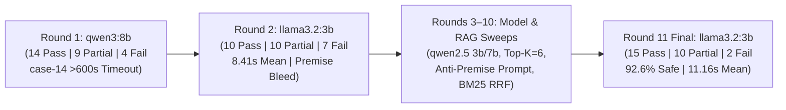

# Evaluation Results Summary

This document details the evaluation methodology, iterative multi-round engineering progression, and verified Round 11 performance metrics for **Oracle RAG**.

Evaluations were executed using the automated testing in [`evaluation/evaluation.py`](evaluation.py) against the 27-case benchmark in [`evaluation/test_cases.json`](test_cases.json), followed by verification of generated ruling, retrieved citation list, and per-query latency measurement.

## 1. Executive Summary & Key Metrics (Round 11 Final)

- **Evaluated Model:** `llama3.2:3b` (`temperature = 0.0`, `OLLAMA_TIMEOUT = 180.0s`)
- **Active RAG Configuration:** Calibrated Hybrid `BM25Okapi` + Reciprocal Rank Fusion (RRF) with expanded semantic candidate pool (`pool_k = 18`) and BM25 lexical rescue, `RAG_TOP_K = 6`, `SIMILARITY_THRESHOLD = 1.2`, sliding-window `ConversationMemory` ($K = 3$ turns)
- **Indexed Corpus During Evaluation:** 3 rulebooks (`D&D 5e Player's Handbook.pdf`, `Call_of_Cthulhu_Investigator_Handbook_7th_Edition.pdf`, `Pathfinder 2e - Player Core 2.pdf`)
- **Total Test Cases Executed:** 27
- **Passed:** 15 / 27 (55.6%)
- **Partial:** 10 / 27 (37.0%)
- **Failed:** 2 / 27 (7.4%)
- **Grounded & Safe Response Rate (Pass + Partial):** 25 / 27 (92.6%)
- **Cross-System Rule Bleed / Hallucinated Editions:** 0 / 27 (0.0%)
- **Timeouts / Stalled Runs:** 0
- **Mean Latency (All 27 Cases):** 11.16 seconds

## 2. Performance

The 27-case suite covers the three evaluation categories defined in [`evaluation/README.md`](README.md):

| Category | Total Cases | Passed | Partial | Failed | Strict Pass Rate | Pass + Partial Rate |
| :--- | :---: | :---: | :---: | :---: | :---: | :---: |
| **Successful Cases** (Typical Rules Lookups) | 9 | 5 | 3 | 1 | **55.6%** | **88.9%** |
| **Difficult Cases** (Memory, Synthesis, Anti-Bleed & Multi-Tome) | 12 | 5 | 6 | 1 | **41.7%** | **91.7%** |
| **Failure / Guardrail Cases** (Out-of-Scope, Injection & Input Guards) | 6 | 5 | 1 | 0 | **83.3%** | **100.0%** |
| **Total** | **27** | **15** | **10** | **2** | **55.6%** | **92.6%** |

## 3. Iterative Progression

Across development, our team executed **11 evaluation rounds**, all archived in [`evaluation/evaluation_rounds/`](evaluation_rounds/):

### Multi-Round Comparative Performance

| Metric | Round 1 (`qwen3:8b`, temp 0.0) | Round 2 (`llama3.2:3b`, temp 0.15) | Round 11 Final (`llama3.2:3b`, temp 0.0 + Hybrid RRF) |
| :--- | :---: | :---: | :---: |
| **Strict Pass** | 14 / 27 (51.9%) | 10 / 27 (37.0%) | **15 / 27 (55.6%)** |
| **Partial** | 9 / 27 (33.3%) | 10 / 27 (37.0%) | **10 / 27 (37.0%)** |
| **Failed** | 4 / 27 (14.8%) | 7 / 27 (25.9%) | **2 / 27 (7.4%)** |
| **Pass + Partial Rate** | 23 / 27 (85.2%) | 20 / 27 (74.1%) | **25 / 27 (92.6%)** |

### What Changed Between Rounds

#### 1. Overcoming the Round 1 Reasoning Hang (`qwen3:8b`)
`qwen3:8b` entered unbounded reasoning loops, timing out past 600s. Switching to `llama3.2:3b` with an enforced 180s timeout eliminated all stalls and cut mean latency.

#### 2. Resolving Round 2 Vulnerabilities (`llama3.2:3b`, `temp = 0.15`)
Dense-only retrieval (`top_k = 4`) and sampling variance caused three primary failure modes:
- **False-Premise Accommodation:** Invented Call of Cthulhu "death saves" and mislabeled 5e rules as 3.5e.
- **Dense Embedding Misses:** Semantic search failed to surface exact domain jargon and multi-condition rules.
- **Delimiter Contamination:** Headers like `--- TRAVELER'S INQUIRY ---` triggered sci-fi *Traveller* hallucinations.

#### 3. Key Interventions in Round 11
- **Hybrid BM25 + Vector RRF (`src/capabilities/rag.py`):** Expanded candidates (`pool_k = 18`) and merged BM25 lexical rescue with vector search via Reciprocal Rank Fusion, resolving rule misses while maintaining strict out-of-scope similarity gating.
- **Native `ConversationMemory` (`src/capabilities/memory.py`):** Replaced ad-hoc string prefixes with structured multi-turn history, fixing multi-step condition tracking.
- **Deterministic Sampling & Guardrails (`src/services/ai_service.py`):** Set `temperature = 0.0`, sanitized delimiters to `--- USER QUESTION ---`, and added an anti-premise prompt.
- **Multi-Tome Balancing & `top_k = 6` (`src/config.py`):** Enforced balanced chunk quotas across rulebooks, preventing larger tomes from crowding out smaller ones.

## 4. Failure Mode & Partial Credit Deep Dive

Round 11 reduced outright failures to **2 (7.4%)** with **0% cross-system bleed** and **0 timeouts**. Non-pass runs (`2 Failed`, `10 Partial`) trace to some root causes:

### Failed Cases (`2 / 27`)
- **OCR Fraction Corruption (`case-09`):** Docling misread unbordered table fractions ($\frac{1}{2}$, $\frac{1}{5}$) on Call of Cthulhu p.269 as `"14 skill"` and `"/ skill"`, causing the model to output inverted success thresholds.
- **Rulebook Split (`case-17`):** The indexed *Investigator Handbook* defers core mechanics to the unindexed *Keeper Rulebook*. Lacking the tens-die rule text, the model conflated bonus/penalty dice with `+1/-1` d6 roll adjustments.

### Partial Cases (`10 / 27`)
- **Over-Granular Chunking (`case-02`, `case-04`, `case-06`):** Subheading-level splitting fragmented compound rules. The model summarized turn flow instead of enumerating all 10 combat actions (`case-04`), truncated the death-save cycle (`case-02`), and omitted secondary Sneak Attack weapon constraints (`case-06`).
- **Multi-Condition Synthesis Limits (`case-10`, `case-13`, `case-14`, `case-16`):** Retrieval surfaced all relevant chunks, but the 3B model struggled to synthesize multiple disjoint clauses, leading to conservative hedging (`case-10`, `case-13`), an oversimplified closing answer (`case-14`), or omitting bonus dice mechanics from prose (`case-16`).
- **Cross-System Retrieval Asymmetry (`case-19`, `case-21`):** In `case-19`, shorthand CoC wording exceeded the similarity threshold, returning only 5e rules. In `case-21`, retrieved CoC chunks lacked an explicit check formula sentence, so the model only answered for 5e.
- **Adversarial Citation Leak (`case-24`):** An injection prompt mentioning "dragons" matched legitimate corpus entities (`DRAGONBORN`). The guardrail fully defeated the jailbreak, but `AIService` still attached the retrieved dragon citations to the refusal.

## 5. Action Items

### Implementations
- [x] **Calibrated Hybrid BM25 RRF + Lexical Rescue:** Implemented in [`src/capabilities/rag.py`](../src/capabilities/rag.py) over an expanded semantic candidate pool (`pool_k = 18`) with section-heading and multi-term BM25 rescue, in-memory caching, and deletion cache invalidation.
- [x] **Sliding-Window Conversational Memory:** Implemented in [`src/capabilities/memory.py`](../src/capabilities/memory.py) and wired into both [`src/services/ai_service.py`](../src/services/ai_service.py) and [`evaluation/evaluation.py`](evaluation.py) for multi-turn reference resolution.
- [x] **Anti-Premise Prompt Protection:** Explicit constraints against false edition and cross-system premises verified in [`src/services/ai_service.py`](../src/services/ai_service.py).
- [x] **Deterministic Sampling & Client Timeout Enforcement:** Configured `temperature = 0.0` and `OLLAMA_TIMEOUT = 180.0s` in [`src/config.py`](../src/config.py) and [`src/models/model_client.py`](../src/models/model_client.py).
- [x] **Balanced Multi-Tome Retrieval:** Per-tome querying with relevance-weighted round-robin allocation verified in [`src/capabilities/rag.py`](../src/capabilities/rag.py).

### Future Improvements
- [ ] **Metadata Breadcrumbs & Parent-Section Merging:** Enrich chunks during ingestion with hierarchical path headers (`System > Edition > Chapter > Section`) and merge short sibling subsections under overview headers.
- [ ] **OCR Artifact & Table Sanitizer:** Add regex normalization during ingestion for common OCR misreads.
- [ ] **Sub-Query Decomposition for Multi-Condition Lookups:** Decompose multi-condition prompts into atomic condition lookups prior to synthesis.
